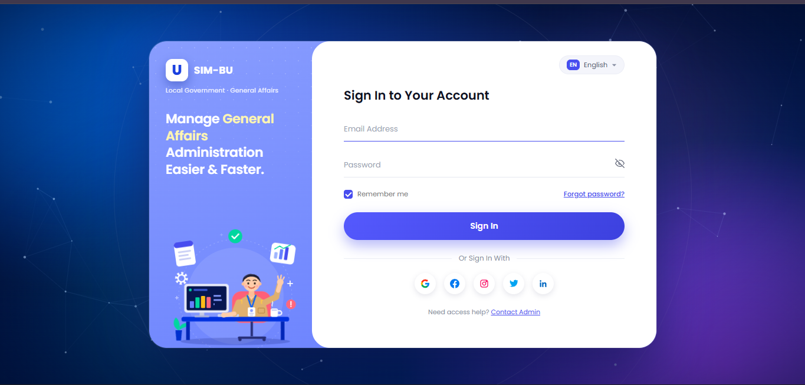
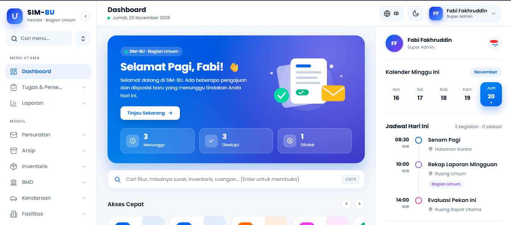

# SIM-BangUM
### Sistem Informasi Manajemen Bagian Umum

<p align="center">
  
  
  
  
</p>

<p align="center">
  Aplikasi web untuk mendukung digitalisasi administrasi, pelayanan, dan operasional Bagian Umum melalui satu sistem yang terintegrasi.
</p>

---

## Tentang Aplikasi

**SIM-BangUM (Sistem Informasi Manajemen Bagian Umum)** adalah aplikasi berbasis web yang dirancang untuk membantu proses administrasi dan operasional Bagian Umum. Sistem menyediakan ruang kerja sesuai peran pengguna, sehingga pegawai dapat mengajukan kebutuhan, pejabat dapat melakukan pemeriksaan dan persetujuan, petugas mengelola bidangnya, serta auditor dapat mengakses laporan.

Aplikasi menggunakan mekanisme autentikasi dan otorisasi berbasis role. Setelah pengguna masuk, sistem mengarahkan pengguna ke dashboard sesuai role yang dimiliki.

## Preview Aplikasi

> Ganti gambar placeholder berikut dengan screenshot aktual aplikasi. Simpan file gambar pada direktori `docs/images/` menggunakan nama file yang sama.

### Halaman Login

<p align="center">
  
</p>

<p align="center"><sub>Halaman autentikasi pengguna SIM-BangUM.</sub></p>

### Dashboard

<p align="center">
  
</p>

<p align="center"><sub>Dashboard aplikasi setelah pengguna berhasil masuk.</sub></p>

## Modul dan Fitur

| Modul | Deskripsi |
|---|---|
| Manajemen Pengguna & Role | Pengelolaan pengguna, penetapan role, dan hak akses. |
| Persuratan | Pengelolaan surat masuk, surat keluar, disposisi, dan dokumen surat. |
| Kearsipan | Pengelolaan klasifikasi arsip, data arsip, serta unggah dan unduh dokumen. |
| Inventaris | Pengelolaan aset, peminjaman aset, item persediaan, dan permintaan stok. |
| Barang Milik Daerah (BMD) | Pencatatan dan pengelolaan data aset barang daerah. |
| Kendaraan | Pengajuan dan pengelolaan permintaan kendaraan dinas. |
| Fasilitas & Ruangan | Pengajuan dan pengelolaan pemesanan ruangan. |
| Perjalanan Dinas | Pengajuan dan pengelolaan perjalanan dinas. |
| Protokol | Ruang pengelolaan kebutuhan kegiatan/protokol. |
| Persetujuan & Disposisi | Pemeriksaan, persetujuan, penolakan, dan tindak lanjut permintaan atau disposisi. |
| Tugas Pengemudi | Daftar tugas, konfirmasi, keberangkatan, dan penyelesaian perjalanan. |
| Laporan & Audit | Akses laporan operasional dan ekspor data laporan. |
| Activity Log | Riwayat aktivitas untuk kebutuhan pemantauan administrator. |

*Daftar di atas merangkum modul yang terlihat dari struktur routing aplikasi. Ketersediaan tindakan pada setiap modul mengikuti implementasi dan hak akses masing-masing role.*

## Role Pengguna

Sistem memiliki dashboard dan akses yang disesuaikan dengan role berikut:

| Role | Tanggung Jawab / Area Kerja |
|---|---|
| `super_admin` | Administrasi sistem, pengguna, role, dan pemantauan aktivitas. |
| `pegawai` | Pengajuan layanan dan kebutuhan operasional serta tindak lanjut disposisi. |
| `kepala_bagian` | Dashboard pejabat, pemeriksaan persetujuan, dan review disposisi. |
| `kasubbag` | Dashboard pejabat, pemeriksaan persetujuan, dan review disposisi. |
| `pengemudi` | Pengelolaan dan pembaruan status tugas perjalanan. |
| `auditor` | Akses laporan dan data untuk kebutuhan audit. |
| `admin_persuratan` | Pengelolaan surat masuk dan surat keluar. |
| `petugas_arsip` | Pengelolaan arsip dan dokumen. |
| `admin_inventaris` | Pengelolaan aset inventaris, peminjaman, dan persediaan. |
| `pengurus_bmd` | Pengelolaan barang milik daerah. |
| `admin_kendaraan` | Pengelolaan administrasi kendaraan. |
| `admin_fasilitas` | Pengelolaan fasilitas dan ruangan. |
| `admin_protokol` | Pengelolaan kebutuhan protokol. |
| `admin_perjalanan_dinas` | Pengelolaan administrasi perjalanan dinas. |

## Teknologi

| Teknologi | Kegunaan |
|---|---|
| PHP 8.3+ | Bahasa pemrograman backend |
| Laravel 13 | Framework aplikasi web |
| MySQL / SQLite | Database (sesuai konfigurasi environment) |
| Blade | Template antarmuka |
| Tailwind CSS | Styling antarmuka |
| Vite | Build tool frontend |
| Alpine.js | Interaksi antarmuka |
| Flatpickr | Komponen pemilihan tanggal |

## Struktur Dokumentasi

```text
Sim-BangUM/
├── app/                  # Controller, model, middleware, dan logic aplikasi
├── database/             # Migration, factory, dan seeder
├── docs/
│   └── images/           # Screenshot aplikasi
├── public/               # Asset publik dan hasil build frontend
├── resources/
│   ├── views/            # Halaman Blade
│   ├── css/              # Sumber CSS
│   └── js/               # Sumber JavaScript
├── routes/               # Definisi route aplikasi
├── README.md             # Dokumentasi utama
└── INSTALL.md            # Panduan instalasi lokal
```

## Instalasi

Ikuti panduan instalasi untuk menyiapkan aplikasi pada komputer atau server lokal.

**[Buka Panduan Instalasi (INSTALL.md)](INSTALL.md)**

Ringkasan perintah:

```bash
git clone https://github.com/Fbi-Boy/Sim-BangUM.git
cd Sim-BangUM
composer install
npm install
```

Lanjutkan konfigurasi file environment, database, migrasi, dan build frontend sesuai panduan instalasi.

## Menjalankan Mode Development

Buka terminal pada direktori proyek, lalu jalankan server Laravel:

```bash
php artisan serve
```

Pada terminal terpisah, jalankan Vite:

```bash
npm run dev
```

Akses aplikasi melalui alamat yang ditampilkan oleh Laravel Development Server, umumnya:

```text
http://127.0.0.1:8000
```

## Catatan Pengembangan

- Jangan mengunggah file `.env`, kredensial, atau data sensitif ke repository.
- Pastikan role pengguna sudah sesuai sebelum menguji dashboard dan menu.
- Gunakan migration untuk menyelaraskan struktur database.
- Simpan screenshot dokumentasi pada `docs/images/`.
- Untuk panduan konfigurasi lengkap, lihat [INSTALL.md](INSTALL.md).

---

<p align="center">
  <strong>SIM-BangUM</strong><br>
  Digitalisasi Administrasi dan Operasional Bagian Umum
</p>
